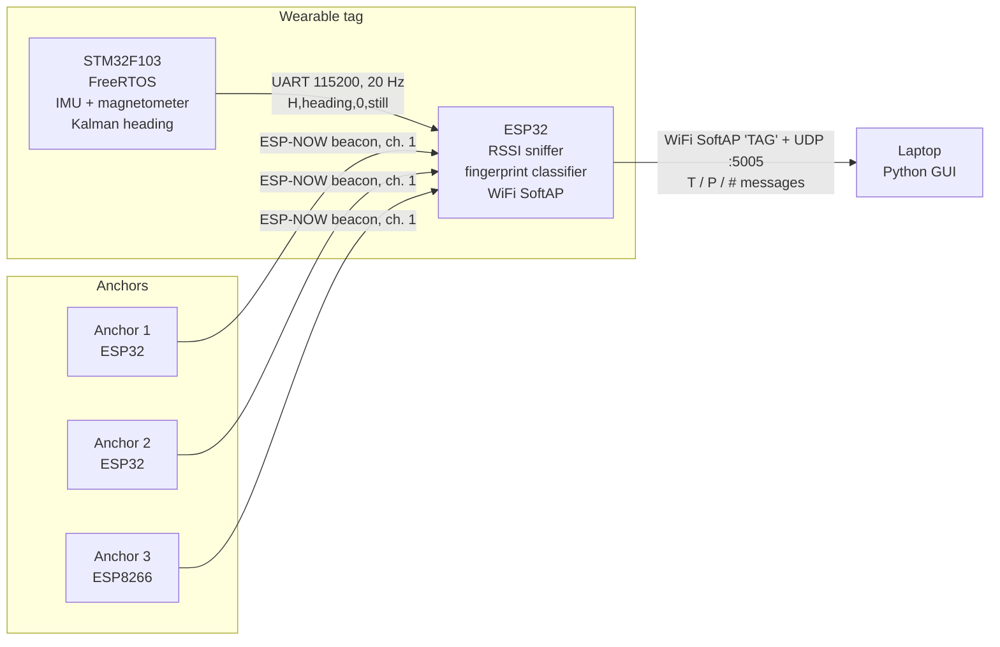

# Wearable Indoor Positioning via WiFi RSSI Fingerprinting (No UWB)

A low-cost, wearable indoor positioning system built from commodity ESP modules instead of UWB or dedicated ranging hardware. Three fixed anchors broadcast ESP-NOW beacons, a wearable tag measures their signal strength (RSSI), and a heading estimate from an IMU + magnetometer Kalman filter makes the RSSI fingerprints orientation-aware. The tag decides which of five predefined positions in a 2.6 × 4.3 m room the wearer is standing at and streams the result to a live Python GUI.

**Stack:** ESP32 · ESP8266 · STM32F103 · FreeRTOS · ESP-NOW · QMC5883L · MPU-9250-class IMU · Python / matplotlib

---

## Demo video

> ▶ Click  to watch the demo on YouTube: [`[https://www.youtube.com/watch?v=VIDEO_ID`](https://youtu.be/-a5GHjzIo-0)](https://youtu.be/-a5GHjzIo-0)


## Table of contents

1. [What it does](#what-it-does)
2. [System architecture](#system-architecture)
3. [Hardware](#hardware)
4. [Repository layout](#repository-layout)
5. [How it works](#how-it-works)
6. [Serial / UDP protocols](#serial--udp-protocols)
7. [Setup and build](#setup-and-build)
8. [Calibration procedure](#calibration-procedure)
9. [Running the demo](#running-the-demo)
10. [Results and limitations](#results-and-limitations)
11. [Troubleshooting](#troubleshooting)
12. [Future work](#future-work)
---

## What it does

- **Anchors** (2× ESP32, 1× ESP8266) broadcast an ESP-NOW beacon every 100 ms on a fixed WiFi channel.
- **Tag** (ESP32 + STM32F103 worn on the body) receives the beacons in promiscuous mode, identifies each anchor by its MAC address and measures per-packet RSSI.
- **STM32F103** runs FreeRTOS firmware that reads a gyro/accelerometer and a magnetometer, calibrates them, and fuses gyro and magnetometer heading in a two-state Kalman filter. It sends the fused heading to the tag at 20 Hz.
- **Tag firmware** matches the measured RSSI (per anchor, per heading) against a fingerprint table recorded in the room, and decides which predefined position the wearer is at.
- **Python GUI** receives the results over WiFi (UDP) and shows the anchors, the positions, an animated position marker and a heading arrow.

The system recognizes **positions**, not continuous (x, y) coordinates: the wearer moves between a small set of marked spots, and the tag reports which one.

---

## System architecture



The tag's ESP32 is a WiFi SoftAP on the **same channel** as the anchors (channel 1), so it can sniff the anchors and talk to the laptop at the same time.

---

## Hardware

| Part | Qty | Role |
|---|---|---|
| ESP32 DevKit V1 | 3 | 2 anchors + the tag radio |
| ESP8266 | 1 | Anchor 3 |
| STM32F103C8T6 | 1 | Tag brain: sensors, calibration, Kalman filter |
| IMU (accel + gyro), `WHO_AM_I` = 0x70 | 1 | Heading rate (MPU-9250-class; see note) |
| QMC5883L magnetometer | 1 | Absolute heading |
| Push button | 1 | Start / "I arrived" (ESP32 GPIO 18 to GND) |
| Power bank (tag), USB power (anchors) | | Power |

> **Note on the IMU:** the firmware reads `WHO_AM_I` = **0x70**, which is the ID of an MPU-6500-class device (a genuine MPU-9250 returns 0x71). Only its accelerometer and gyroscope are used; the heading comes from the QMC5883L.

### Wiring

| Connection | Pins |
|---|---|
| IMU → STM32 | I2C1 |
| QMC5883L → STM32 | I2C2, address 0x0D |
| STM32 → tag ESP32 | STM32 USART1 TX (PA9) → ESP32 GPIO 16 (RX2), common GND, 3.3 V logic |
| Tag button | ESP32 GPIO 18 → GND (internal pull-up) |
| Redo button (calibration only, optional) | ESP32 GPIO 26 → GND |

### Room and placement

- Room: **2.6 m × 4.3 m**, origin at one corner.
- Anchors in a triangle at the same height (about 1 m), identical orientation and fixed TX power. Approximate positions (measure and edit yours): A1 (0.2, 0.2), A2 (2.4, 0.2), A3 (1.3, 4.1) m.
- Five marked floor positions: the four corners of the walking area and the centre.
- The tag is **held in the hand**, at chest height, flat, with the antenna end free, and always the same way. Body shadowing is large, so the way it is held matters.

---

## Repository layout

> Rename these to match your repository.

```
.
├── stm32/                         # STM32F103 firmware (CubeIDE / HAL + FreeRTOS)
│   ├── main.c                     # tasks, calibration flow, UART telemetry
│   ├── MPU-9250.c / MPU-9250.h    # IMU driver (accel + gyro)
│   ├── QMC5883L.c / QMC5883L.h    # magnetometer driver + calibration
│   └── gyro_mag_fusion.c / .h     # 2-state Kalman filter (heading, gyro bias)
├── esp32_anchor/                  # ESP32 anchor sketch (Arduino, ESP-NOW broadcast)
├── esp8266_anchor/                # ESP8266 anchor sketch
├── esp32_tag_calibration/         # tag sketch: button-driven RSSI calibration capture
├── esp32_tag_demo/                # tag sketch: fingerprint classifier + UDP telemetry
├── python/
│   └── viewer.py                  # live GUI (UDP → matplotlib)
├── data/                          # calibration logs (RSSI fingerprints)
├── docs/                          # photos, screenshots, wiring diagram
└── README.md
```

---

## How it works

### 1. STM32 firmware (FreeRTOS)

Three tasks (`xTaskCreate`):

| Task | Priority | Job |
|---|---|---|
| `qmcTask` | 2 | Magnetometer init and calibration, then 50 Hz heading reads; posts the newest heading to a one-slot queue (`xQueueOverwrite`) |
| `mpuTask` | 2 | IMU init and bias calibration, then 200 Hz reads; runs the Kalman filter predict (every sample) and update (when a new magnetometer heading arrives) |
| `printTask` | 1 | Waits for a `g_ready` flag (set once both calibrations are done and the filter is initialised), then sends `H,<heading>,0,<still>` to the tag at 20 Hz over DMA UART |

Synchronization:
- **I2C** uses interrupt-driven HAL transfers (`HAL_I2C_Mem_Read_IT` / `Write_IT`). The completion callbacks call `vTaskNotifyGiveFromISR`, so a task blocks while the transfer runs.
- **UART TX** uses DMA (`HAL_UART_Transmit_DMA`); a **binary semaphore** is released from the TX-complete callback so print calls never overlap.
- The magnetometer task notifies the IMU task when its calibration is done, so the two calibrations run one after the other.

**Boot sequence** (messages are forwarded to the tag and shown on the laptop):
1. Magnetometer calibration: rotate the board flat through several full circles for 20 s.
2. IMU gyro/accel bias calibration: keep the board still and flat (~2 s).
3. A 12 s window to attach the magnetometer to the body (hard-iron offsets change once mounted).
4. The Kalman filter starts from the first magnetometer heading.

### 2. Sensor drivers

The IMU and magnetometer drivers are written from scratch on top of the STM32 HAL I2C layer (no third-party sensor libraries): register maps, init and configuration, burst reads, unit conversion and calibration.

- **IMU:** ±4 g, ±500 °/s, 200 Hz output, ~20 Hz gyro and accel low-pass filters (DLPF setting 4); gyro and accel bias calibration over 1000 samples; a stationary detector (`MPU9250_IsStationary`).
- **QMC5883L:** 50 Hz, ±2 G, OSR 512; hard-iron (per-axis centre of min/max) and soft-iron (per-axis scale) calibration; tilt-uncompensated heading `atan2(y, x)`, so the tag must be held flat.

### 3. Heading Kalman filter

Two states: heading θ and gyro bias *b*.

- **Predict:** `θ += (ω − b)·dt`, with covariance propagation (`Q_TH = 0.05`, `Q_B = 0.001`).
- **Update:** the magnetometer heading corrects θ and *b* (`R_MAG = 25`), with the residual wrapped to ±180°.

The bias state removes the long-term gyro drift; the magnetometer keeps the heading absolute.

### 4. Anchors

Each anchor sends an ESP-NOW broadcast every 100 ms on channel 1 with the payload `{id, seq}` at a fixed TX power (ESP32: 11 dBm, ESP8266: 10 dBm; per-anchor differences are absorbed by the calibration). Anchors do no computation.

### 5. Tag: RSSI measurement

The tag's ESP32 runs in promiscuous mode on channel 1 and filters management/action frames that carry the ESP-NOW header. **Anchors are identified by the sender MAC address** (802.11 header, bytes 10–15), not by the payload: the payload layout differs between the ESP32 and the ESP8266 and the `id` byte collided in testing. RSSI is read per packet from the receive metadata.

### 6. Calibration firmware (`esp32_tag_calibration`)

A button-driven tool that records fingerprints without a laptop next to you:

1. Press the button: 2 s countdown + 1 s settling (settle into your posture), then 10 s of recording (~100 packets per anchor).
2. Per anchor it prints the packet count, mean, median, standard deviation, min and max of the raw per-packet RSSI, plus the circular mean and spread of the measured heading.
3. The order is automatic: each position at 0°, 90°, 180°, 270°, then the next position. A second button (or `r`) redoes the previous capture.

Output lines:

```
D,session,cfg,pos,x,y,head_nom,head_meas,head_std,anchor,n,mean,median,std,min,max
```

### 7. Tag: fingerprint classifier (`esp32_tag_demo`)

The table `FP[position][heading bin][anchor]` holds the calibration means. Every second the tag averages RSSI per anchor and the heading, then:

1. **Stability:** a second is "stable" if no anchor changed by more than 4 dB and the heading by no more than 25° compared with the previous second.
2. **Movement:** it counts as "moved" when RSSI differs by more than 6 dB (or the heading by more than 40°) from the last confirmed position.
3. **Decision (after 3 stable seconds):** for each candidate position (excluding the current one) it computes
   `cost = mean((measured − fingerprint)² / 4²) + 0.7 × (number of anchor-rank mismatches)`
   using the fingerprints of the current **heading bin** (relative heading rounded to 0/90/180/270). The lowest cost is a *candidate*.
4. **Confirmation (2 more stable seconds):** the candidate must be chosen again, with the current position also in the competition. If the current position wins instead, the candidate is dropped and no move is shown. This filters spurious transitions such as `P1 P1 P1 P2 P1 P1`.
5. **Button fallback:** pressing the button at any time ("I have arrived") measures the next 3 s regardless of stability.

The heading is relative: pressing the button at position 1 facing your "0°" direction sets the zero. The STM32 heading is mirrored relative to the calibration labels, so the tag uses `zero − heading`.

### 8. Telemetry and GUI

The ESP32 tag is a SoftAP named `TAG` (password `12345678`) on channel 1. It sends UDP broadcast packets to port 5005; `viewer.py` on a laptop connected to `TAG` draws the room, anchors, positions, the marker (animated glide between positions) and the heading arrow.

---

## Serial / UDP protocols

**STM32 → tag (UART, 115200 8N1)**

| Line | Meaning |
|---|---|
| `H,<heading_deg>,0,<still>` | Fused heading at 20 Hz (`still` = 1 if the IMU stationary test passes) |
| any other text | Calibration messages, forwarded to the user as `# STM: ...` |

**Tag → laptop (UDP port 5005, also printed on USB serial)**

| Line | Meaning |
|---|---|
| `# ...` | Status text (STM32 calibration messages, "calibration done", candidate / rejected) |
| `S,1` | Test started (reset the plot) |
| `T,<ms>,<state>,<pos>,<x>,<y>,<heading>` | 5 Hz telemetry. `state`: 0 moving, 1 measuring, 2 at position |
| `P,<from>,<to>,<x>,<y>,<heading>,<cost>,<margin>` | A confirmed move from one position to another |

---

## Setup and build

### Requirements

- STM32CubeIDE (HAL + FreeRTOS via CMSIS-RTOS) for the STM32F103C8T6.
- Arduino IDE with **ESP32** and **ESP8266** board packages.
- Python 3 with `matplotlib`.

### Steps

1. **STM32:** open the project, build and flash. Verify at 115200 baud that the boot messages appear and, after calibration, `H,...` lines.
2. **Anchors:** flash `esp32_anchor` to two ESP32s (`ANCHOR_ID` 1 and 2) and `esp8266_anchor` to the ESP8266 (`ANCHOR_ID` 3). Boot prints `Anchor N ready, MAC xx:xx:...`. Write down each MAC.
3. **Tag:** put the three MACs in the `ANCH_MAC` table in both tag sketches. Flash `esp32_tag_calibration` first (to record fingerprints), then `esp32_tag_demo`.
4. **Wire** the STM32 TX to the ESP32 GPIO 16, common ground, and the button to GPIO 18.
5. **Viewer:** `pip install matplotlib`, then `python viewer.py`.

Keep everything (anchor positions, height, orientation, TX power, channel) **unchanged** between calibration and use. If any of it changes, recalibrate.

---

## Calibration procedure

1. Power the anchors, the STM32 and the tag (power bank). Wait for the STM32 calibration to finish.
2. Hold the tag exactly as it will be held in the demo, over the first floor mark.
3. Press the button. After the countdown and the 10 s recording, the tag prints three `D,` lines (one per anchor). Turn 90° in place and press again; repeat for 180° and 270°.
4. Move to the next position and repeat until all captures are done.
5. Copy the `D,` lines from the Serial Monitor to a file (`data/`).
6. Put the per-anchor means into the `FP` table in the demo sketch.

---

## Running the demo

1. Power everything; wait for `STM32 CALIBRATION DONE` on the laptop terminal or Serial Monitor.
2. Connect the laptop to the WiFi network `TAG` (password `12345678`) and run `python viewer.py`.
3. Stand at **position 1**, facing your "0°" direction, in the calibration posture. Press the button.
4. Walk to another position and hold still. After a few seconds the marker glides to the new position.
5. If the position does not update by itself, press the button when you arrive.

---

## Results and limitations

What was measured:

| Finding | Value |
|---|---|
| RSSI noise within one 10 s capture | ≈ 1.6 dB standard deviation |
| Effect of the wearer's facing direction at the same spot | up to ≈ 19 dB |
| Drift of the same spot between two sessions | ≈ 7 dB RMS |
| Separation of the closest position pair with 9 positions | ≈ 3.7 dB |

What this means:

- **Body shadowing dominates.** Your body between the tag and an anchor costs several dB, so a strong signal does not always mean "near that anchor". That is why the fingerprints are recorded per heading.
- **Fingerprints are only valid for the setup they were recorded in.** Moving an anchor, changing how the tag is held, or attaching different hardware shifts RSSI by several dB. Recalibrate in the same setup you use.
- **3 anchors cannot separate many positions.** Nine positions in this room were too close (≈ 3.7 dB apart, comparable to the session drift), so the demo uses **5 well-separated positions**.
- **Positions, not coordinates.** This is a classifier over a few marked spots, not a continuous tracker.
- The heading is tilt-uncompensated, so the tag must be held flat.


---

## Troubleshooting

| Symptom | Likely cause / fix |
|---|---|
| An RSSI column is always `-127` or an anchor never appears | Wrong MAC in `ANCH_MAC`, anchor on another channel, or anchor not powered |
| Two anchors land in the same column | Identification by payload `id` instead of MAC (use the MAC table) |
| Heading stays 0 / no `H,` lines | STM32 not finished calibrating, or TX/RX not wired to GPIO 16, or no common ground |
| 90° and 270° appear swapped | The STM32 heading is mirrored vs the calibration labels; flip the sign in `relHeading()` |
| Viewer stays on "waiting…" | Laptop not on WiFi `TAG`, firewall blocking UDP 5005 for Python, or the test was not started with the button |
| Position never changes by itself | RSSI changes too little between positions; press the button on arrival, or check the fingerprint table against the live `rssi` line |
| Wrong positions, consistently | Fingerprints no longer match the setup: recalibrate with the exact demo assembly |

---

## Future work

- Replace the blocking `HAL_Delay(12000)` (the "attach the magnetometer" window) in the IMU task with `vTaskDelay`, so the scheduler is not blocked during that wait.
- Add tilt compensation for the magnetometer heading using the accelerometer.
- Replace the nearest-fingerprint rule with a probabilistic classifier that returns a confidence and can reject uncertain results.
- Use the walking direction (heading while moving) to limit which positions are possible from the current one.
- Record fingerprints in several sessions and average them to reduce session drift.
- Extend from a few positions to continuous (x, y) tracking with more anchors and step-based dead reckoning.

